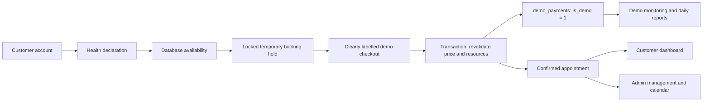

# Phase 5 — completed college-project prototype

The customer-to-admin demonstration now runs through the existing PHP/MySQL application on **http://127.0.0.1:8088/**. Registration, authentication, health declarations, actual availability, temporary holds, clearly simulated payments, confirmation, customer history and administration use the same `bella_vista_spa` database.

**DEMO PAYMENT ONLY — No actual money will be transferred.** Demo GCash, Demo Maya and Demo Card are simulated method names. No real payment credentials are collected and the demo path does not call a merchant gateway.

## Issues found and completed

| Existing issue / missing behavior | Final behavior |
|---|---|
| Earlier blanket unavailability caused by empty staff/schedules; room-first selection obscured alternatives | All seven active rooms are checked by actual service/date/start, with room/staff/cleaning/error outcomes separated. The approved real therapist schedule remains intact. A guarded development seed supplies explicitly fictional staff when needed for a separate demo installation. |
| Real checkout was unconfigured and the previous workflow saved confirmed/unpaid bookings | New bookings use `booking_mode=demo`, a configurable temporary hold, and local simulated checkout. Confirmation follows a committed demo receipt and resource revalidation. Existing unpaid/real-ledger records retain their mode and values. |
| No simulated receipt ledger | New `demo_payments` records have `is_demo=1`, a `DEMO-…` reference, owner/appointment IDs, method, option, total, simulated amount, remaining balance, percentage snapshot and timestamp. |
| Admin area contained only staffing setup | Implemented overview, searchable/filterable appointments, details/actions, daily and seven-day room calendar, current room/cleaning status, simulated payment monitoring, daily reports and editable prototype settings. |
| Customer payment/history copy assumed real verification | Demo amounts and statuses are explicitly labelled. Real verified-payment records and simulated transactions render in separate sections. Rescheduling/cancellation history is linked to the original appointment. |
| Inactive staff could not be reactivated and names could not be edited | Admin roster supports add, edit name, activate/deactivate and published Available/Unavailable shifts. Existing upcoming reservations protect staff from invalidating changes. |
| Retry could return checkout without the chosen downpayment option | Booking retries return the same hold and preserve full/downpayment selection. Receipt retries return the original simulated transaction. |
| Shared header exposed customer booking to administrators | Role-aware navigation directs administrators to appointments; database role checks remain authoritative. |

## Architecture and data flow

Public/customer routes remain under `public/`. Shared domain functions remain in `app/modules/`; common admin loading/rendering is in `app/admin-page.php` and `app/components/admin/`. Admin routes are thin entry points rather than a second booking backend. PDO prepared statements, existing sessions, CSRF, escaping and database-role authorization are retained.

### Scheduling

Operating days are Monday–Sunday, 13:00–21:00, `Asia/Manila`. Starts are every 30 minutes. Single/couples durations are 60 minutes; family duration is 90. Capacity is validated against both service and room. The server calculates pricing, including ₱750 beyond four family guests up to six.

Rooms occupy `[start, cleaning_end)`, including the mandatory 30-minute cleaning buffer. Both earlier and later conflicts are checked. Therapists occupy `[start, treatment_end)` and need an explicit available shift without an overlapping break/assignment. Treatments can end at 21:00 and cleaning at 21:30.

All scheduling writers lock `business_settings.id=1 FOR UPDATE` inside a transaction before reading and assigning resources. This simple shared mutex is appropriate to the seven-room prototype and prevents competing rooms or therapists from being assigned concurrently. The browser's availability response is advisory; save and payment completion revalidate it.

### Simulated checkout

1. `create_booking()` stores an actual `awaiting_payment` demo hold, authoritative price snapshots and therapist assignments. The reference is a reservation identifier until completion.
2. `customer/payment.php` renders the existing-route demo checkout component. Full/downpayment choice, expected amount and revision are checked on POST with the authenticated owner and CSRF token.
3. `complete_demo_payment()` takes the scheduling lock, verifies ownership/idempotency/revision, validates hold expiry and future operating window, recalculates price, and rechecks room/therapist availability.
4. It inserts the `is_demo=1` receipt and updates the same appointment to confirmed with demo paid/partially-paid status in one transaction. No provider API or real `payments`/`payment_attempts` record is created.
5. A repeated request key returns the original receipt. Different competing keys cannot pay the same hold twice. Abandonment and expiry release allocations.

Default assumptions are **30% downpayment** and **15-minute hold**, editable under **Demo settings**. Integer-centavo arithmetic uses half-up rounding. A displayed quote that no longer matches the current server plan is rejected for review. For ₱800, the downpayment is ₱240 and remaining balance ₱560. A subsequent simulated balance completion is supported.

The real provider framework and verified ledger are retained separately and remain unconfigured. Demo mode does not replace their records or treat a simulated receipt as provider verification.

### Changes and policy review

Customers may cancel/reschedule with at least six hours' notice; the exact deadline is eligible. Rescheduling keeps the original resource allocation until the replacement passes checks and is saved. The appointment ID, service/room/guest price and payment ledger remain attached.

Paid demo cancellation creates an `is_demo=1` policy/admin review request with no invented requested amount. No actual or simulated refund is issued automatically. Administrators can record a review note/state; the underlying receipt remains a simulation record. Customer reschedules are applied atomically and appear in change history; admins review/acknowledge those changes rather than using a separate approval queue.

Administrators can perform guarded status transitions, cancel with a recorded reason/late flag, safely move a future visit and assign exactly the configured number of available therapists. They cannot confirm a pending demo hold by bypassing payment or mark a future treatment completed prematurely. Medical answers are omitted from the admin appointment interface.

## Database changes

Migration **`database/migrations/005_demo_admin.sql`** was applied to the existing database after a backup. It adds:

- Separate `demo_payments` table, foreign keys, unique request/transaction references, appointment-option uniqueness, an indexed timestamp and enforced demo/amount checks.
- `demo` as an additional appointment booking mode and an administration day/status index.
- Prototype checkout enablement, percentage and hold settings, separate from the real business payment policy.
- `therapists.is_demo` and simulated refund-review metadata, notes, reviewer and review timestamp.

It does not drop, reset, or overwrite existing accounts, reservations or verified payment records. The existing administrator and original confirmed/unpaid appointment were preserved. The CLI migration runner checks versions and safely skips applied scripts; the fresh schema includes 002, 003 and 005. No migration 004 was necessary for the earlier availability code/data repair.

The private backup is `var/phase5-before-migration.sql`. Private configuration, backups, database files, sessions and fixture credentials are excluded from the distribution ZIP.

## Real and development staffing

All required rooms are active: SR-1/SR-2/SR-3, CS-1/CS-2 and FL-1/FL-2. The existing real staff record and authorized shifts were retained privately; employee identity and exact shift dates are omitted from this source copy. There is one therapist per appointment by default, so one real therapist cannot cover simultaneous bookings in several rooms.

The guarded **`tools/seed-demo.php`** requires CLI, a local database, explicit `--development-only`, and development configuration. It inserts missing service/room records without duplicating IDs or deleting reservations. A conflicting existing room/service mapping requires review. Existing real employees and their schedules are not invented or overwritten.

When active staff are missing, it creates three `[DEMO] Fictional Therapist` records (`is_demo=1`) and 30 days of Philippine-time shifts. An explicit `--add-demo-staff` option supports an intentionally fictional development presentation even when real staff exist. Seed testing was performed only in an isolated `_test` database; the live installation still has zero fictional staff. Repeated seed runs created 90 shifts then zero additional shifts.

## Verification and delivery

**522 automated checks passed, zero final failures**, covering current prototype behavior and retained Phase 2/3 branches. The actual port-8088 flow passed registration/login, SR-1 at 13:00, full and downpayment simulations, persisted confirmation/history, admin management/calendar/report synchronization, stale/double submission rejection and record preservation.

The browser independently completed Demo Card checkout for **BV-0B491152366F50F4** and verified its same reference, SR-1, ₱800 demo-paid status, 14:00–14:30 cleaning interval and separate simulated receipt in admin monitoring. It checked desktop/mobile views, seven-day calendar, and the ₱560 outstanding balance for the downpayment case. Screenshots contain labelled QA accounts and fictional medical answers.

All temporary live QA accounts, appointments, simulated receipts and declarations were removed after review. Exact snapshots verified that the original customer/admin records, original appointment, real staff/schedules, settings and real payment ledger were unchanged. No permanent fictitious booking statistics were left to populate the dashboard.

See **`PHASE-5-TESTING.md`** for counts and mandatory scenarios, **`PHASE-5-FILE-CHANGES.md`** for changed files, **`FILE-LIST.txt`** for the distribution, **`RUBRIC-CHECKLIST.md`** for rubric coverage, and **`DEFENSE-WALKTHROUGH.md`** for the presentation.

## Remaining limits

- Real merchant processing and actual refunds are outside this explicitly simulated prototype. No live-provider integration is claimed.
- Publish real shifts beyond 12 November, or explicitly seed labelled fictional staff in a development installation for later presentation dates.
- Calendar availability describes physical room intervals; appointment booking additionally checks staffing and valid duration/closing rules.
- Appointment tables paginate 200 records; demo monitoring shows up to 500 matching rows with date/search filters; upcoming shift view shows up to 100 records.
- Customer reschedule review uses saved change history rather than an approval-request queue.
- Verification used XAMPP PHP/MariaDB on Windows and port 8088. Standalone Oracle MySQL 8 and Apache were not separately re-run in this phase; compatibility-oriented routes and SQL remain in place. Formal production deployment and a formal accessibility audit are not part of this college delivery.
